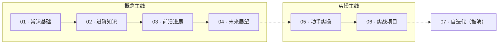

# AI-Learning-Hub-2026

> **一句话定位**：一个**教科书级、系统化**的 AI 学习中枢——从**各领域从业者的常识素养**，延伸到**愿意动手的极客/前沿实践**。以四层×三维矩阵组织、配 05–06 实操主线，并为前沿/极客向内容明确标注「可选/实验性」，让结构容纳持续扩展，而非一次填满。帮你建立 AI 的**常识基础、进阶知识、前沿进展、未来展望**，理解"哪些 AI 能做什么、怎么做、为什么这么做"，以及它的发展演进。

---

## 这个仓库是什么 / 不是什么

- ✅ **是**：一份有主线、有结构、可循序渐进的学习资源与讲解集合。以"学习计划"牵头，把散落各处的优质资源按我们的框架重新组织。
- ❌ **不是**：又一个简单堆砌链接的"收藏夹"，也不是教你从零训练大模型的工程手册。

当前网上资料**泛滥但碎片化**，系统的、教科书级的入门资源稀缺，更少见一份**为"各领域从业者建立 AI 常识"量身定制的学习计划**。本仓库就是要填补这个空档。

---

## 受众与前提

- **默认主线受众**：**各领域从业者**——来自生物医学、统计、工程、人文社科等各行各业，有一定编程基础（如 Python/R）与逻辑思维，但**不以 AI 研发为职业**；目标是在不深陷工程的前提下，建立 AI 的常识、架构演进与判断框架。
- **延伸受众**：愿意动手的极客/实践者——本仓库"前沿"层中标注为「前沿 / 极客向 · 可选」的小节（如本地推理引擎、个人智脑讨论）即为这部分内容，可按需深入。
- **不要求**：深厚的数学或机器学习背景——本仓库对数学**随用随补**，不系统重学；标注「可选」的部分亦不强求。

---

## 核心原则

1. **系统 > 碎片**：按"层 × 维"矩阵组织，而非按热点罗列。
2. **锚定演进**：以 **DeepSeek R1（2025-01）** 作为国内 AI 大规模普及与开源拐点的标志性锚点，向上/向下追溯因果，而非孤立记名词。
3. **只引用，不整搬**：对已有优秀合集（见下方"上游致谢"）**只做链接指针、注明出处**，不复制其内容；本仓库的讲解与筛选为原创。
4. **常识优先**：先建立"能/不能做什么"的清醒认知，再深入原理；警惕炒作。
5. **分层容纳，不为填满**：内容按"常识主线 + 前沿/可选分支"显式分层（见各文件中的「前沿 / 极客向 · 可选」标签）。一个知识库的价值在于其结构能否容纳后来者持续添加，而非一次覆盖所有讨论。

---

## 结构矩阵（本仓库骨架）

四层（深度递进）× 三维（切面）：

| 层 ＼ 维 | 编程基础 | 结构演进 | 用途扩展 |
|---|---|---|---|
| **常识基础** | AI 的最小编程语境 | 规则→ML→DL→Transformer→大模型极简脉络 | 能/不能做什么、常见误区 |
| **进阶知识** | HF/API 动手、提示词即编程 | Transformer 深解、预训练/微调/RLHF、MoE | RAG / Agent / MCP / 科研落地 |
| **前沿进展** | 本地小模型（Ollama/llama.cpp）+ 有限硬件推理引擎 | **DeepSeek R1 锚点**（MoE+RL+CoT）、推理模型范式 | 深度研究 Agent、AI 编程、进展速读 |
| **未来展望** | AI 辅助编程成默认 | AGI 边界、世界模型、端侧 AI | AI 作"生活要素"、伦理对齐、持续跟进 |

---

## 目录

- [01 · 常识基础](01-commonsense.md)
- [02 · 进阶知识](02-advanced.md)
- [03 · 前沿进展](03-frontier.md)
- [04 · 未来展望](04-outlook.md)
- [05 · 动手实操](05-动手实操.md)（实操主线·工具基础：获取模型 / 配环境 / 搭 Agent / 写提示词 / RAG）
- [06 · 实战项目](06-实战项目.md)（实操主线·场景落地：以 dsh「外置智脑」为范例，端到端搭建个人 Agent）
- [07 · 自迭代与自构建](07-自迭代与自构建.md)（**探索线·推演**：把"AI 改系统"拆成隔离 / 归档 / 回滚 / 带外管理的工程闭环）
- [资源索引](resources.md)（按模块精选，注明出处与核验日期）
- [演进时间轴](timeline.md)（注明出处）
- [学习路径索引](LEARNING-PATHS.md)（纵切推荐顺序）
- [中文译校资料（cn-notes/）](cn-notes/)（精选英文材料的中文译校版，已译校 12 篇）
- [English README](README-en.md)

> 注：03·前沿进展 含「本地推理引擎（有限硬件跑大模型）」子章与「本地部署务实前提」提示；04·未来展望 含「个人智脑 vs 集中化云端」讨论（标观点属性）与「开放问题 / 未解之谜」中性罗列（均非事实断言）；05–06 为实操主线，工具迭代极快，以各项目官方文档为准；07 为**探索线**，含大量【推演】与【未核实】项，不构成可行性背书。

---

## 中文译校资料（双轨制）

本仓库对**精选关键英文材料**采用"双轨制"：

- **原轨（原地保留）**：英文原文链接仍指向原作者/上游仓库，**不复制、不改动**，保持一手鲜活。
- **译校轨（我方）**：在本仓库 `cn-notes/` 下放置**译校/改编的中文版**，经翻译与校对，便于中文读者，并**明确注明原文出处与版权**。

> 译校版是"学习向的提炼/改编"，非逐字翻译；版权归原作者。当前已译校 12 篇，后续可继续扩充。其中 3Blue1Brown、Karpathy 等 YouTube 原视频在大陆需梯子，对应中文译校版已收入 `cn-notes/`，可直接阅读（详见 [resources.md](resources.md) H 区）。

---

## 主线地图：你从哪来到哪去

本仓库的"**概念主线（01–04）+ 实操主线（05–06）**"合起来是一条完整的学习旅程（[07](07-自迭代与自构建.md) 为可选的探索延伸）：

> **动机（为何要懂）→ 机制（它怎么动）→ 范式（怎么组织成系统）→ 实操（怎么跑起来）→ 实战（怎么落地一个应用）→ 持续判断（怎么不被甩下）**

不必全走；按目标取段即可。

| 层 | 定位 | 学完你能做什么（产出） |
|---|---|---|
| [01 常识基础](01-commonsense.md) | 建立"能/不能做什么"的清醒地图 | 说清 AI 边界、识别炒作与幻觉 |
| [02 进阶知识](02-advanced.md) | 搞懂内部结构、会用工具做实事 | 跑通 API / HF、写结构化提示词 |
| [03 前沿进展](03-frontier.md) | 以 DeepSeek R1 为锚理解推理范式 | 理性速读新进展、本地低成本实验 |
| [04 未来展望](04-outlook.md) | 建立未来框架与真实不确定性 | 判断趋势、不盲从"共识" |
| [05 动手实操](05-动手实操.md) | 获取模型 / 配环境 / 搭 Agent / 做 RAG | 本地跑模型、组装能调工具的 Agent |
| [06 实战项目](06-实战项目.md) | 端到端做一个"外置智脑"式应用 | 交付一个可复现、可自托管的个人 Agent |
| [07 自迭代与自构建](07-自迭代与自构建.md) | 探索线（可选·推演）：能否让系统参与改造自己 | 设计一个可回滚、可验证的实验闭环（构想级） |

**两条主线的关系**：
- **概念主线（01–04）**：讲"为什么"，按 01→02→03→04 系统学。
- **实操主线（05–06）**：讲"怎么用"，**05 是工具基础**（获取模型/配环境/搭 Agent/提示词/RAG），**06 是场景落地**（把 05 的零件拼成一个真实应用）。

两条线**并列互补、互不替代**：05/06 不重复底层原理，只讲操作与取舍；想懂"为什么这么配"，回到 01–04 对应小节。各文件头部均有 📌 主线导航相互指路。

> **07 是探索线（可选·未验证）**：把 05–06 的能力再往前推一步——让系统参与改造自己（自迭代/自构建）。它当前无实测，只提供工程骨架与待验证清单，**不影响主线完整**。

---

## 如何使用

- **系统学（理论向）**：按 01→02→03→04 顺序，建立完整认知；需要时再跳 05/06 动手。
- **动手优先（实践向）**：先 [05 · 动手实操](05-动手实操.md) 打工具底子，再 [06 · 实战项目](06-实战项目.md) 拼一个真实应用；遇到原理疑问回 01–04 查"为什么"。
- **按需查**：已有编程基础可直接跳 02；只想"懂个大概"只读 01 与 04。
- **动手轻**：全程"概念 + 体感"，用现成 API / Hugging Face / 本地小模型；重训练标为【可选】。
- **识别分支**：带「前沿 / 极客向 · 可选」标签的小节属行业前沿动手/讨论内容（如 03 的本地推理引擎、04 的个人智脑讨论），是主线的延伸而非必读——按兴趣与动手能力取用。

---

## 上游致谢与关系说明

本仓库不重复造轮子。以下优秀合集是**上游总入口**，我们以链接方式引用、并注明出处；它们的内容由原作者维护，我们不复制：

- **Datawhale 中文系列**（最适合中文读者）：[happy-llm](https://github.com/datawhalechina/happy-llm)（LLM 原理，Karpathy 中文版）、[llm-universe](https://github.com/datawhalechina/llm-universe)（新手做应用/API/RAG）、[llm-cookbook](https://github.com/datawhalechina/llm-cookbook)（吴恩达课中文改编）。
- **XiaomingX/awesome-llm**：带演进时间轴与权威榜单（Chatbot Arena / OpenCompass / LiveBench）——本仓库[时间轴](timeline.md)据此整理并注明出处。
- **ifLabX/Awesome-LLM-Learning**、**Hannibal046/Awesome-LLM**：系统化 LLM 资源清单。
- **josephmisiti/awesome-machine-learning**：经典"地图的地图"（2025-11 已更新含 LLM）。
- **llmbook-zh（赵鑫等《大语言模型》）**：中文权威教材。

> **为什么仍要做自己的**：上述合集多为"全量索引"或"面向开发者"，缺少一份**为各领域从业者定制的、按"常识—进阶—前沿—展望"分层、且锚定 DeepSeek R1 演进**的系统讲解。这正是本仓库的独特价值。

---

## 许可

- 本仓库**原创内容**（讲解、筛选、矩阵框架）采用 **CC BY 4.0**：可署名转载、演绎。
- 链接指向的**他人资源**保留其原有许可；引用时均已注明出处。

---

## 内容立场（事实 / 观点）

- 本仓库原创讲解力求准确，并标注资料**核验日期**；技术参数以各项目官方 README / 社区实测为准。
- 其中标注为"讨论 / 观点"的内容（如 04 · §4.4「个人智脑 vs 集中化云端」及署名讨论段、§4.5「开放问题 / 未解之谜」）为作者分析与判断或中性罗列，**非事实断言或趋势预测**，欢迎商榷与补充。
- 我们不追求"覆盖一切"——一个知识库的价值在于其结构能否容纳后来者持续添加。把最有价值的 20% 沉淀好，其余留给时间与贡献者。

---

## 贡献

欢迎提 Issue / PR：补充优质资源、纠正错漏、提出更好的结构建议。请遵循"注明出处、不整搬"原则。
